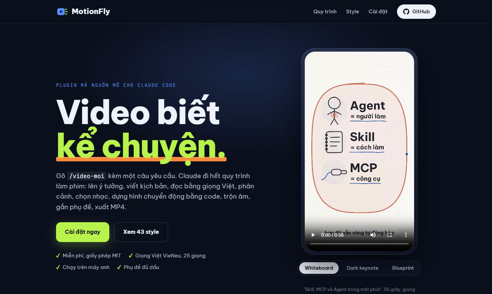
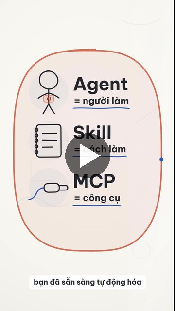
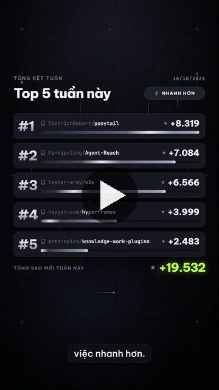
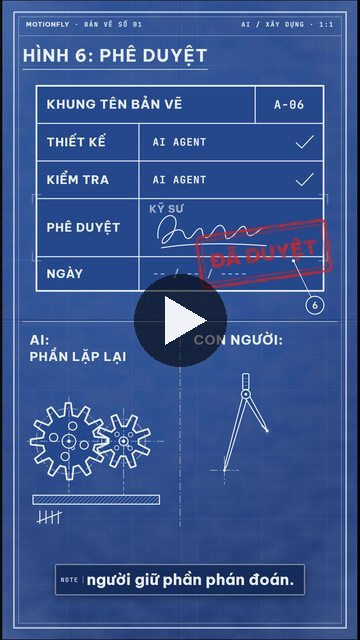
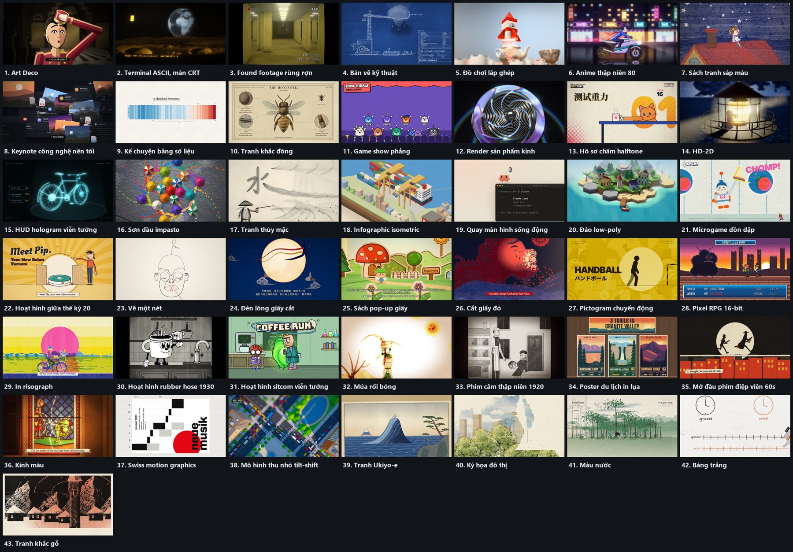

# MotionFly: video biết kể chuyện

Trang giới thiệu, video mẫu và thư viện style: **https://andyluu98.github.io/MotionFly/**

[](https://andyluu98.github.io/MotionFly/)

Plugin Claude Code làm video tiếng Việt trọn gói. Anh nhập một yêu cầu, Claude đi hết quy trình làm phim: ý tưởng, kịch bản, giọng đọc, phân cảnh, nhạc nền, dựng hình, trộn âm, phụ đề, xuất MP4.

```
/video-moi Làm video 1 phút giải thích Skill, MCP và Agent trong Claude Code, style whiteboard
```

## Quy trình

| Bước | Việc | Ra file | Duyệt |
|---|---|---|---|
| 1 | Brief: chủ đề, khán giả, style, độ dài, giọng | `brief.json` | Hỏi khi thiếu |
| 2 | Ý tưởng, kịch bản theo cảnh | `script.json` | Có |
| 3 | Giọng VieNeu, tự chấm phát âm bằng Whisper, mốc từng từ | `voice.wav`, `words.json` | |
| 4 | Phân cảnh neo theo từ khóa lời đọc | `storyboard.json`, `timeline.json` | |
| 5 | Nhạc nền, nhạc tự hạ khi có lời, -14 LUFS | `mix.wav` | |
| 6 | Dựng từng cảnh bằng code (agent song song), kiểm tra, người chấm độc lập | `compositions/`, `checks/sheet.jpg` | Có |
| 7 | Render, ghép âm thanh, phụ đề | `renders/*.mp4`, `phude.srt` | |

Nói "tự làm hết" để bỏ các bước duyệt.

## Video mẫu

Ba video dưới đây do MotionFly làm trọn gói từ một câu yêu cầu: kịch bản, giọng đọc, nhạc, hình động, phụ đề. Bấm vào ảnh để xem video.

| Whiteboard | Dark keynote | Blueprint |
|:---:|:---:|:---:|
| [](https://andyluu98.github.io/MotionFly/site/media/skill-mcp-agent.mp4) | [](https://andyluu98.github.io/MotionFly/site/media/top5-github-tuan.mp4) | [](https://andyluu98.github.io/MotionFly/site/media/ai-xay-dung-blueprint.mp4) |
| Skill, MCP và Agent trong một phút (56 giây) | 5 repo GitHub hot nhất tuần | AI trong ngành xây dựng: Agent, Skill và MCP |

## Style dựng sẵn



**43 style**, chia 9 nhóm: vẽ tay và hội họa (bảng trắng, màu nước, thủy mặc, sáp màu, sơn dầu, vẽ một nét, ký họa), đồ họa và chữ (Swiss, Art Deco, bản vẽ kỹ thuật, terminal CRT, kính màu, mở đầu phim điệp viên, pictogram), thông tin và keynote (keynote nền tối, kể chuyện số liệu, infographic isometric, quay màn hình, HUD hologram), chất liệu và 3D (pop-up giấy, đồ chơi lắp ghép, kính, đảo low-poly, tilt-shift), hoạt hình và anime, phong cách game, in ấn và khắc, truyền thống Á Đông (cắt giấy đỏ, đèn lồng giấy, múa rối bóng, Ukiyo-e), điện ảnh và thời kỳ.

Danh mục đầy đủ có tên tiếng Việt, nhu cầu phù hợp và ảnh xem trước: `styles/index.json` và trang giới thiệu. Mỗi style là một file `styles/<tên>/STYLE.md`; thêm style mới chỉ cần thêm thư mục và một dòng trong `index.json`, không sửa code.

## Cài đặt

Cần có sẵn: [Claude Code](https://claude.com/claude-code), [Node.js](https://nodejs.org) 22 trở lên, Python 3.10 trở lên, [ffmpeg](https://ffmpeg.org/download.html) trong PATH. Nên có [uv](https://docs.astral.sh/uv/).

```
/plugin marketplace add andyluu98/MotionFly
/plugin install motionfly@motionfly
/video-cai-dat
```

`/video-cai-dat` kiểm máy, báo thiếu gì, rồi tự tải phần còn lại (khoảng 2 đến 3 GB): môi trường Python ở `~/.motionfly/venv`, giọng VieNeu, model Whisper.

Không có card NVIDIA vẫn chạy: giọng dùng CPU, nhạc dùng file anh đưa hoặc nhạc tổng hợp bằng code. Repo không kèm file nhạc của bên thứ ba vì điều khoản các kho nhạc miễn phí cấm phân phối lại.

## Dùng với Codex, Antigravity, Gemini CLI

MotionFly viết cho Claude Code nhưng các agent khác cũng chạy được:

1. Clone repo, chạy kiểm máy: `python tools/setup/doctor.py --install`.
2. Tạo file hướng dẫn trong thư mục làm video: `python tools/setup/entry.py <thư-mục>` (ghi `AGENTS.md` cho Codex, `GEMINI.md` cho Antigravity và Gemini CLI).
3. Mở agent ở thư mục đó và gõ yêu cầu làm video như bình thường.

Agent không có agent con thì dựng theo **chế độ tuần tự**: mỗi cảnh viết xong chạy `tools/scene_check.py`, mở ảnh ra xem, sửa, rồi mới sang cảnh sau. Trước khi render bắt buộc qua **cổng chặn** `tools/gate.py` (đủ bước kiểm tra, biên bản chấm phải chép mã in trên tờ duyệt, mọi số trên hình phải có nguồn, không đoạn hình đứng yên quá 1,5 giây). Bộ đồ nghề `templates/kit/` (nét sáp, chữ viết tay, tô màu, lật trang, 1.879 icon nét Lucide tra bằng `tools/icon_find.py`, danh sách khối chuyển động dựng sẵn của HyperFrames trong `goi-y-catalog.md`) và video mẫu đã duyệt `examples/crayon-claude-tinh-nang-moi/` giúp hình đẹp ngay mà không bó sáng tạo.

## Cấu trúc

```
skills/      video-moi (điều phối), giong-doc, nhac-nen, dung-video, video-cai-dat
agents/      dung-canh (dựng một cảnh), nguoi-cham (chấm độc lập)
styles/      style card (nguồn ghi đầu mỗi file)
tools/       voice/ (VieNeu, Whisper), music/synth.py, audio/mix.py, timeline.py, assemble.py, sheet.py, gate.py, scene_check.py, icon_find.py, setup/
templates/   khuôn cảnh, font Be Vietnam Pro, kit/ (bộ đồ nghề window.MF)
vendor/      code chép từ repo khác, giấy phép gốc
```

## Nguồn

Lắp ghép từ HyperFrames, lemo-opuscar, bestagentkits/motion-video-skill, VieNeu-TTS, faster-whisper và một số repo khác. Chi tiết từng file, phiên bản, giấy phép: [NOTICE.md](NOTICE.md).

## Giấy phép

Code của repo: MIT ([LICENSE](LICENSE)). Phần chép từ nơi khác giữ giấy phép gốc (xem NOTICE.md).
